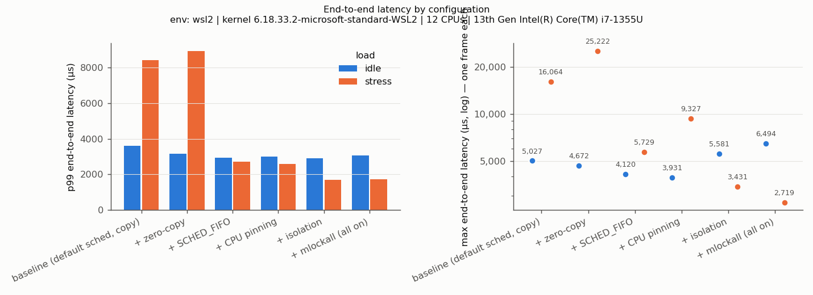
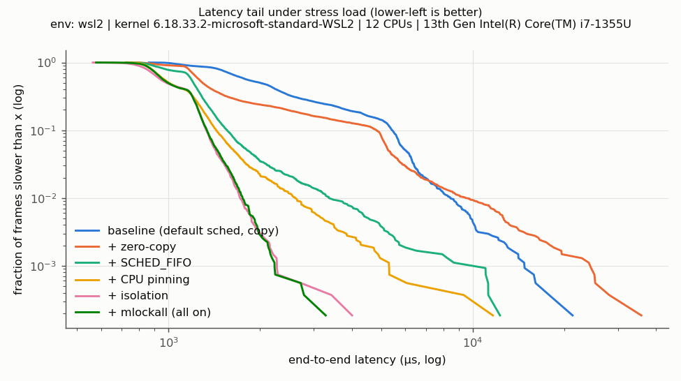
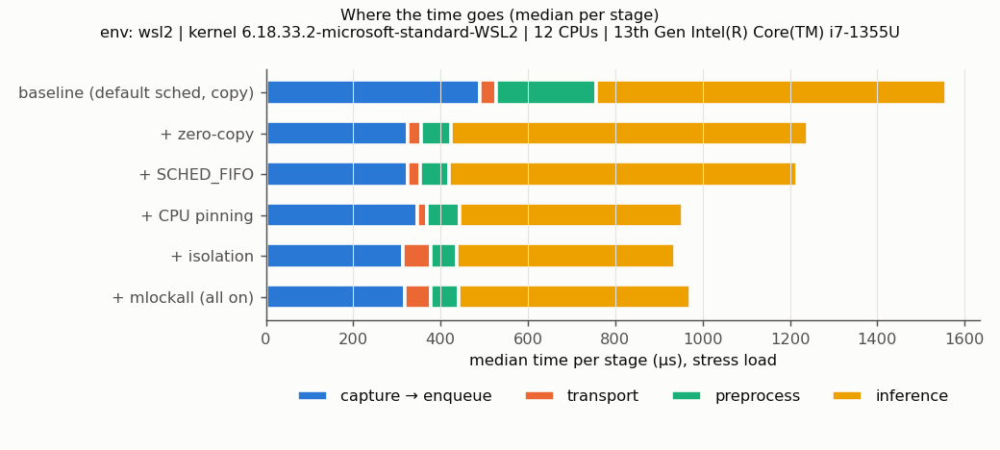

# framepipe — a real-time camera-to-policy pipeline in C++ on Linux

framepipe moves 640x480 frames from a 60 Hz two-stream source to an ONNX policy model in a separate process through a lock-free shared-memory ring, timestamping every stage with `CLOCK_MONOTONIC`. It measures how zero-copy transport, SCHED_FIFO, CPU pinning, CPU isolation and `mlockall` change end-to-end latency, jitter and two-stream skew, idle and under `stress-ng` load, and uses bpftrace to show where late frames come from. On WSL2 under load, all fixes together cut p99 end-to-end latency from 8,396 µs to 1,727 µs (4.9×) and p99 frame-period jitter from 6,416 µs to 1,047 µs, with zero dropped frames.

> Every number in this README comes from `results/wsl2/20261014-125450/` (experiments, 3 runs per cell, median shown) or `results/wsl2/profile-20261014-134035/` (scheduler traces). Environment: WSL2, kernel 6.18.33.2-microsoft-standard-WSL2, preemption mode `none`, 12 logical CPUs (Intel i7-1355U), clocksource `tsc`. See [Limitations](#limitations).

## Architecture

```
            fp_producer (process)                               fp_consumer (process)
 +-------------------------------------+                 +----------------------------------------------+
 | fp_prod0  SCHED_FIFO 80 (optional)  |   ring 0        | fp_cons  SCHED_FIFO 70 (optional)            |
 |  sleep until t0 + k*16.667 ms       |  (POSIX shm,    |                                              |
 |  t_capture -> render -> t_enqueue --+--> SPSC, 8 x  --+--> t_dequeue -> preprocess -> ONNX Runtime    |
 |                                     |   900 KB slots) |                 t_infer_start   t_infer_end  |
 | fp_prod1  same t0, same deadlines   |   ring 1        |                                              |
 |  t_capture -> render -> t_enqueue --+---------------->+--> t_dequeue -> read -> release (skew only)   |
 +------------------+------------------+                 +------------------------^---------------------+
                    |   doorbell++ ; FUTEX_WAKE    (futex word in the same shm)   |   FUTEX_WAIT
                    +-------------------------------------------------------------+

  zero-copy: producer renders INTO the slot, consumer preprocesses FROM the slot
  copy:      producer renders privately + memcpy in; consumer memcpy out (baseline)
  logs:      producer.csv (every scheduled frame, incl. drops) + consumer.csv (every frame received)
```

| Path | What it is |
|---|---|
| `src/common/spsc_ring.hpp` | lock-free single-producer/single-consumer ring (acquire/release, no CAS) |
| `src/common/shm.hpp` | shared-memory layout, RAII mapping, futex doorbell |
| `src/common/rt.hpp` | SCHED_FIFO, CPU pinning, mlockall, timer slack, thread names |
| `src/producer.cpp` | 60 Hz absolute-deadline frame source (synthetic, or V4L2 webcam) |
| `src/consumer.cpp` | ring consumer, per-stage timestamps, CSV logging |
| `src/policy_model.*` | ONNX Runtime wrapper, one thread, zero per-frame allocation |
| `src/ring_test.cpp` | ring correctness/throughput test |
| `scripts/analyze.py` | tables, contribution tables, plots |
| `scripts/runq_fp.bt`, `scripts/profile.sh`, `scripts/profile_report.py` | scheduler tracing and attribution |
| `run_experiments.sh` | reproduces every experiment and plot |

## Reproduce

```bash
scripts/setup_deps.sh                      # apt packages, ONNX Runtime, Python venv, the model
scripts/build.sh                           # CMake build -> build/
sudo scripts/check_env.sh                  # what this machine supports -> results/env.json
build/fp_ring_test                         # ring correctness check
./run_experiments.sh --duration 30 --reps 3                         # all experiments (~45 min)
sudo scripts/profile.sh --configs baseline,mlock --tool bpftrace    # scheduler traces
```

`docs/MILESTONES.md` walks through the build one milestone at a time.

## Experiments

Each configuration ran 3 × 30 s idle and 3 × 30 s under `stress-ng --cpu 12 --vm 2 --vm-bytes 256M --io 1`.
Producer threads run at FIFO 80, the consumer at FIFO 70; pinning puts them on CPUs 10, 9 and 11.
"Isolation" keeps the load generator on CPUs 0–8 (`taskset`), since this kernel has no `isolcpus`.

| config | transport | scheduler | pinned | load kept off pipeline CPUs | mlockall |
|---|---|---|---|---|---|
| baseline | copy | default (SCHED_OTHER, EEVDF) | – | – | – |
| + zero-copy | zero-copy | default | – | – | – |
| + SCHED_FIFO | zero-copy | SCHED_FIFO | – | – | – |
| + CPU pinning | zero-copy | SCHED_FIFO | yes | – | – |
| + isolation | zero-copy | SCHED_FIFO | yes | yes | – |
| + mlockall (all on) | zero-copy | SCHED_FIFO | yes | yes | yes |
| all on − X (ablations) | everything on except one fix | | | | |

The ladder gives each fix's contribution on top of the previous ones; the ablations give each
fix's individual contribution with everything else held fixed.

## Results

End-to-end = capture → inference end, stream 0. Frame budget at 60 Hz = 16,667 µs. All values µs.

**Under stress-ng load**

| config | e2e p50 | e2e p99 | e2e max | wake-up p99 | jitter p99 | skew p99 | drops |
|---|---:|---:|---:|---:|---:|---:|---:|
| baseline (default sched, copy) | 1,678 | 8,396 | 16,064 | 5,438 | 6,416 | 6,748 | 0 |
| + zero-copy | 1,326 | 8,901 | 25,222 | 5,130 | 6,216 | 5,584 | 1 |
| + SCHED_FIFO | 1,227 | 2,729 | 5,729 | 917 | 1,234 | 1,067 | 0 |
| + CPU pinning | 982 | 2,572 | 9,327 | 835 | 1,129 | 1,471 | 0 |
| + isolation | 981 | 1,681 | 3,431 | 1,391 | 970 | 922 | 0 |
| + mlockall (all on) | 1,012 | 1,727 | 2,719 | 1,382 | 1,047 | 989 | 0 |

**Each fix's individual contribution (ablation): change in e2e p99 when that one fix is removed from "all on"**

| removed | under stress | idle |
|---|---:|---:|
| CPU isolation | +1,249 | +19 |
| pinning + isolation | +993 | −23 |
| zero-copy | +400 | +390 |
| SCHED_FIFO | +1 | −114 |
| mlockall | −46 | −134 |

Idle, every configuration's p99 lands between 2,920 and 3,602 µs. Full tables, including p99.9,
the cumulative ladder and the idle results: [`results/wsl2/20261014-125450/results.md`](results/wsl2/20261014-125450/results.md).





### What the numbers say

- **SCHED_FIFO is the biggest single step under load** (p99 8,901 → 2,729 µs in the ladder): without it, the pipeline's threads queue behind 12 stress workers.
- **Once the load is kept off the pipeline CPUs, FIFO no longer matters** (removing it costs +1 µs p99): with nothing else on those CPUs there is nothing to win against. Isolation is the fix whose removal hurts most (+1,249 µs).
- **Zero-copy is the only fix that helps when idle** (+390 µs p99 when removed): it removes two 900 KB copies per frame, which no scheduling change can.
- **mlockall had no measurable effect**: there was no memory pressure, so there was nothing to page out.
- **Load made the typical frame faster** (all-on p50 1,012 µs under stress vs 2,154 µs idle). Working hypothesis: on WSL2, idle virtual CPUs are slow to wake and run at lower clocks; busy ones are not. The same effect would explain why isolation *raised* producer wake-up p99 (835 → 1,391 µs): it let the pipeline CPUs go idle. An exploratory test (not in this repo) that kept the pipeline CPUs busy with low-priority filler pointed the same way.

### Why the tail happens (bpftrace)

`scripts/runq_fp.bt` records, for every wake-up of a pipeline thread, how long it was runnable but waiting for a CPU (run-queue delay), using the same clock as the frame timestamps, so waits can be matched to individual frames. Under stress, 15 s per config:

| run-queue delay, µs | baseline p50 / p99 / max | all on p50 / p99 / max |
|---|---|---|
| fp_prod0 (stream 0 capture) | 39.0 / 4,045.7 / 14,993.0 | 16.0 / 29.0 / 311.0 |
| fp_prod1 (stream 1 capture) | 26.0 / 4,168.6 / 10,720.0 | 15.0 / 43.0 / 79.0 |
| fp_cons (consumer + inference) | 39.0 / 5,835.5 / 14,193.0 | 5.0 / 64.5 / 1,532.0 |

- **Baseline:** all 9 of the slowest 1% of stream-0 frames overlap a run-queue wait ≥ 200 µs by a thread on that frame's path. The tail is time spent waiting for a CPU.
- **All on:** the pipeline threads were preempted 2 times in 15 s, both by `migration/10`, a kernel stop-class thread that outranks any FIFO priority. Only 2 of the 9 slowest frames overlap a ≥ 200 µs wait. The other 7 were slow while the thread already had the CPU, so the guest scheduler does not explain them.
- **Observer effect:** in the baseline trace, 10,897 of 11,050 preemptions of pipeline threads were by bpftrace's own userspace reader. The baseline threads float across all CPUs, so pinning the tracer to CPUs 0–8 cannot keep it away from them, and its slowest-1% frames (≥ 15,005 µs) are worse than in the untraced runs. The baseline trace shows the *mechanism*; take magnitudes from the untraced tables above. In the all-on trace the tracer preempted the pipeline 0 times.

## Limitations

- **Environment.** WSL2 on a Windows laptop. The guest scheduler is real, but Windows can pause or slow a whole virtual CPU; SCHED_FIFO only orders work *inside* the guest. From inside the guest a host pause can look like a run-queue wait or like slow execution, so the trace cannot fully separate the two. The kernel runs in preemption mode `none`, so a woken FIFO thread can still wait for kernel code to reach a preemption point. The i7-1355U is hybrid (performance + efficiency cores), and Windows decides which physical core backs each virtual CPU. Absolute numbers are not representative of bare metal or PREEMPT_RT.
- **Synthetic frames.** The "camera" is a software timer, so producer wake-up lateness stands in for sensor timing, and rendering the test pattern is part of capture → enqueue. A real camera is hardware-clocked and arrives through a driver. The V4L2 path is implemented but untested here (no camera under WSL2).
- **Start of the clock.** End-to-end starts when the producer thread wakes, not at the scheduled frame time; the oversleep before that is reported separately as wake-up lateness.
- **Isolation is emulated** with `taskset` on the load generator, not `isolcpus`/`nohz_full`. Kernel threads and interrupts can still run on the pipeline CPUs (e.g. `migration/10` above).
- **Tools.** `perf` is not packaged for the WSL2 kernel, so profiling uses bpftrace only. Ubuntu 22.04's bpftrace 0.14 cannot run `BEGIN`/`END` blocks, so the script has none.
- **Statistics.** 3 runs × 1,800 frames per cell. p99.9 rests on about 2 frames per run and max on 1; treat them as anecdotes.
- **Tiny model.** A 3-layer CNN (24,039 parameters) with random weights stands in for inference cost, not task quality.
- **Single machine, one consumer.**
